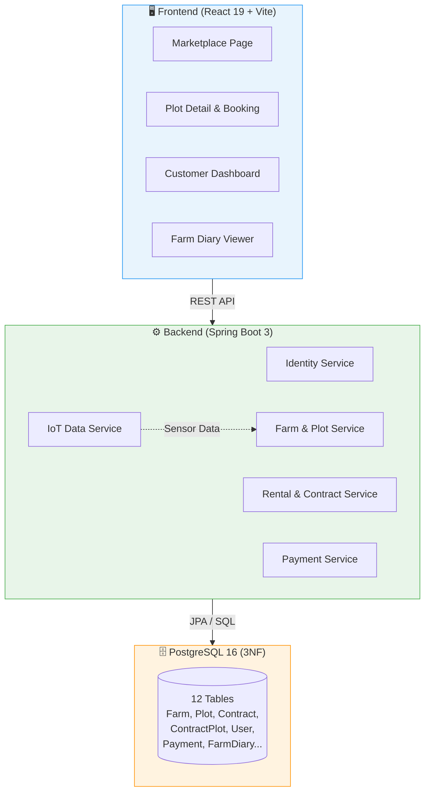
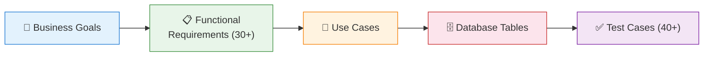
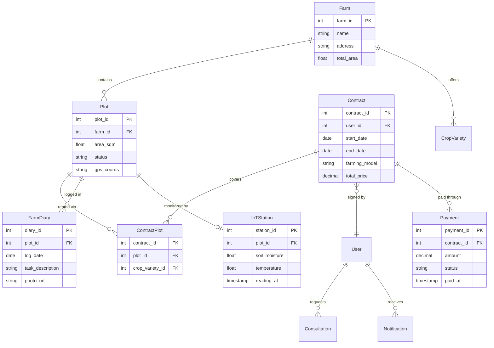
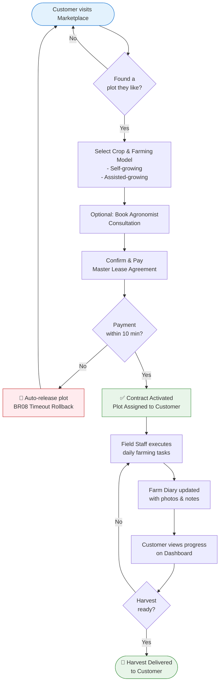

# 🌾 Farmely — Smart Farm Plot Rental Platform

> A full-stack web platform where urban residents can rent individual farm plots, choose between self-growing or assisted-growing models, and track their crops through IoT sensors and daily farm diaries.

<div align="center">

[](#)
[](#)
[](#)
[](#)

</div>

---

## What This Project Is

This is a **capstone project (ISP392)** at FPT University, built by a team of 4 students over the Spring 2026 semester. I worked as the **System Analyst & Requirements Lead** — meaning I was responsible for gathering requirements, designing the database, writing business rules, and making sure what we built actually matched what users needed.

The idea: City people want to grow their own vegetables but don't have land or expertise. Farmely lets them rent a pre-prepared farm plot online, pick what crops to grow, and either farm it themselves (with guidelines) or pay for staff to handle it. They can check on their plot anytime through IoT sensors and daily photo logs.

---

## System Architecture Overview



---

## My BA Contributions

### 1. Business Rules Document (SSoT)

I wrote and maintained a single document containing **27 business rules** (BR01–BR27) that the whole team referenced during development. Some examples:

- **BR01 — Master Lease Agreement:** One contract covers multiple plots. We chose this over a shopping-cart model because it simplified payment processing and reduced database complexity.
- **BR08 — 10-Minute Reservation Hold:** When someone starts booking a plot, it's held for 10 minutes. If they don't pay, it automatically releases back. This prevented "ghost bookings" where plots looked taken but weren't actually paid for.
- **BR27 — Lump-Sum Pricing:** All farming services are priced as a flat fee, not itemized by materials used. We made this trade-off (YAGNI) to avoid building an inventory tracking system that wasn't core to the MVP.

### 2. Requirements Traceability Matrix (RTM)

I created a spreadsheet that maps each business goal → functional requirements → use cases → database tables → test cases. This helped us catch **5 missing edge cases** early (e.g., what happens if a customer tries to cancel a contract mid-harvest?) before any code was written.



### 3. Database Design (ERD)

Designed the schema in Draw.io with **12 tables** normalized to **3NF**:



Key decision: `ContractPlot` is a junction table that links one contract to multiple plots — this is how the Master Lease Agreement (BR01) works at the database level.

### 4. Use Cases & UAT Testing

- Wrote detailed Use Case specs with Main Flow, Alternative Flows, and Exception Flows for each core feature (booking, payment, cancellation, farm diary).
- Created **40+ UAT test scenarios** and ran them manually with the team before demo day. We tested happy paths, cancellation edge cases, and payment timeout rollbacks.

---

## User Booking Flow (BPMN-style)



---

## Tech Stack

| Component | Technology | Why we chose it |
| :--- | :--- | :--- |
| **Backend** | Java Spring Boot 3, Spring Data JPA | Solid framework for handling transactional business logic (contracts, payments) |
| **Frontend** | React 19, Vite, Tailwind CSS, Zustand | Fast development cycle with good state management |
| **Database** | PostgreSQL 16 (3NF) | Reliable, free, and handles our relational data model well |
| **DevOps** | Docker, Docker Compose | So all 4 of us could run the same environment locally |
| **Analysis** | Draw.io, Postman, Vitest | For ERD diagrams, API testing, and unit tests |

---

## Running Locally

```bash
git clone https://github.com/toilanguyenzz/farmely.git
cd farmely

# Start all services via Docker Compose
docker compose up -d

# Or run frontend only
cd frontend
npm install
npm run dev
```

---

## What I'd Do Differently

- **Architecture:** We went with a modular monolith instead of microservices. For a team of 4 with a 3-month deadline, this was the right call — but if we had more time, splitting the booking and payment services would improve scalability.
- **IoT Integration:** Currently IoT data is manually entered. With more time, I'd integrate real MQTT sensor streams for automatic soil moisture alerts.

---

<div align="center">
Built by <strong>Ta Nguyen Khoi Nguyen & Team</strong> · FPT University · ISP392 Capstone (Spring 2026)
</div>
