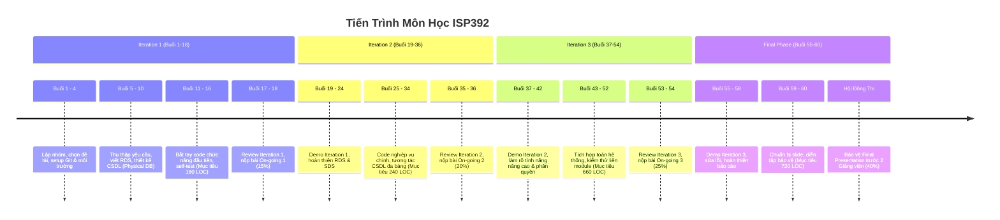

# 📘 CẨM NANG TOÀN DIỆN MÔN HỌC ISP392
## Information System Programming Project (Dự án Lập trình Hệ thống Thông tin)

> **Mã môn:** ISP392 | **Syllabus ID:** 14182  
> **Số tín chỉ:** 3 (150 giờ: 45h trên lớp/contact hours + 105h tự học)  
> **Quyết định ban hành:** 377/QĐ-ĐHFPT ngày 04/09/2026 | **Điểm đạt tối thiểu:** 5.0/10  
> **Điều kiện tiên quyết:** PRJ302, SWE201c, Pass LAB211  
> **Hình thức:** Project-Based Learning (Làm việc nhóm 4-5 thành viên, học Offline)

---

## 📑 MỤC LỤC
1. [Tổng Quan Môn Học & Mục Tiêu](#1-tổng-quan-môn-học--mục-tiêu)
2. [Chuẩn Đầu Ra (CLOs)](#2-chuẩn-đầu-ra-clos)
3. [Cơ Cấu Điểm & Yêu Cầu Đánh Giá](#3-cơ-cấu-điểm--yêu-cầu-đánh-giá)
4. [Công Nghệ & Công Cụ Yêu Cầu](#4-công-nghệ--công-cụ-yêu-cầu)
5. [Lộ Trình Dự Án (Roadmap 60 Buổi - 3 Iterations)](#5-lộ-trình-dự-án-roadmap-60-buổi---3-iterations)
6. [Hồ Sơ Sản Phẩm Cần Nộp (Deliverables)](#6-hồ-sơ-sản-phẩm-cần-nộp-deliverables)
7. [Ngân Hàng 33 Câu Hỏi Vấn Đáp (Constructive Questions) & Hướng Dẫn Trả Lời](#7-ngân-hàng-33-câu-hỏi-vấn-đáp-constructive-questions)
8. [Bí Quyết & Kinh Nghiệm Qua Môn Điểm Cao (A / A+)](#8-bí-quyết--kinh-nghiệm-qua-môn-điểm-cao)
9. [Tiêu Chuẩn "Tiểu Đồ Án Tốt Nghiệp" (70% Khối Lượng Capstone)](#9-tiêu-chuẩn-tiểu-đồ-án-tốt-nghiệp-70-khối-lượng-capstone)

---

## 1. TỔNG QUAN MÔN HỌC & MỤC TIÊU

ISP392 là môn **đồ án thực chiến** mô phỏng một dự án phát triển phần mềm doanh nghiệp thu nhỏ. Sinh viên không chỉ viết code mà phải trải qua toàn bộ quy trình: phân tích yêu cầu, thiết kế kiến trúc/CSDL, lập trình theo mô hình MVC, kiểm thử, tích hợp và bảo vệ trước hội đồng.

### Nhiệm vụ trọng tâm của sinh viên:
* **Làm việc nhóm (4 - 5 người):** Bầu nhóm trưởng (Team Leader), phân chia vai trò rõ ràng (BA, UI/UX, Backend, Frontend, Database, Tester).
* **Quản lý dự án chuyên nghiệp:**
  * Source code, issues, milestones quản lý qua **GitLab** hoặc **GitHub**.
  * Tài liệu, biên bản họp, báo cáo lưu trữ trên **OneDrive / Google Drive**.
* **Tuân thủ quy chế chuyên cần:** Tham gia tối thiểu **80% số buổi học** trên lớp (vắng quá 20% sẽ bị cấm thi Final Presentation).
* **Quy trình Agile/Scrum rút gọn:** Triển khai sản phẩm qua 3 chặng lặp (Iteration 1, 2, 3) và buổi bảo vệ tổng kết (Final Presentation).

---

## 2. CHUẨN ĐẦU RA (CLOs)

| Mã CLO | Tên Chuẩn Đầu Ra | Nội Dung Chi Tiết |
| :---: | :--- | :--- |
| **CLO1** | Phân tích yêu cầu | Đọc hiểu, phân tích yêu cầu dự án, chủ động đặt câu hỏi làm rõ phạm vi nghiệp vụ với Giảng viên/Khách hàng. |
| **CLO2** | Thiết kế hệ thống | Hiểu và áp dụng mô hình kiến trúc **MVC**, nguyên lý **OOP** để thiết kế các module code và thiết kế CSDL quan hệ chuẩn hóa dựa trên giao diện người dùng (UI). |
| **CLO3** | Lập trình Web | Thành thạo kỹ năng lập trình Web doanh nghiệp dựa trên nền tảng **Java Web** (Servlet/JSP) hoặc **.NET** (ASP.NET Core/MVC). |
| **CLO4** | Thái độ chuyên nghiệp | Thể hiện thái độ làm việc nhóm nghiêm túc, kỷ luật, quản lý tiến độ, tuân thủ deadline và chuẩn mực lập trình (coding conventions). |
| **CLO5** | Giao tiếp & Thuyết trình | Thực hành kỹ năng thuyết trình, bảo vệ giải pháp kỹ thuật và giao tiếp hiệu quả giữa các thành viên và trước hội đồng đánh giá. |

---

## 3. CƠ CẤU ĐIỂM & YÊU CẦU ĐÁNH GIÁ

> [!IMPORTANT]
> **Điều kiện tiên quyết để được bảo vệ Final Presentation:**
> 1. Điểm trung bình quá trình (On-going Assessments) phải đạt **$\ge$ 5.0 / 10**.
> 2. Chuyên cần $\ge$ 80% số buổi.
> 3. Không có hành vi gian lận (cheating/plagiarism) trong toàn bộ quá trình. Gian lận tại Final Presentation sẽ bị đánh trượt ngay và **không được thi lại (no resit)**.

### 3.1. Bảng Trọng Số Đánh Giá

| Thành Phần Đánh Giá | Loại Điểm | Trọng Số | Thời Lượng | Tiêu Chí LOC Tối Thiểu (Mỗi SV) | Thành Phần Đánh Giá Chi Tiết |
| :--- | :---: | :---: | :---: | :---: | :--- |
| **On-going Assessment 1** (Iteration 1) | Quá trình | **15%** | 45 phút / nhóm | **180 LOC** (rated LOC) | • Source Code & Demo DB: **10%** • RDS Document: **20%** • Product (Độ phức tạp & LOC): **70%** |
| **On-going Assessment 2** (Iteration 2) | Quá trình | **20%** | 45 phút / nhóm | **240 LOC** (rated LOC) | • Source Code & Demo DB: **10%** • RDS Document: **20%** • Product (Độ phức tạp & LOC): **70%** |
| **On-going Assessment 3** (Iteration 3) | Quá trình | **25%** | 45 phút / nhóm | **660 LOC** (tích lũy) | • Source Code & Demo DB: **15%** • RDS Document: **25%** • Product (Độ phức tạp & LOC): **60%** |
| **Final Project Presentation** | Cuối kỳ | **40%** | 45 phút / nhóm (Hội đồng 2 GV) | **720 LOC** (tích lũy toàn dự án) | • Software Product/Demo: **40%** • Requirement Analyzing: **20%** • Software Designing: **20%** • Team Working & Q&A: **20%** |

### 3.2. Quy Tắc Về LOC (Lines of Code)
* **Rated LOC:** Là số dòng code hợp lệ (chứa business logic do chính sinh viên viết trong các Controller, DAO/Repository, Service, Model, Form Validation, JS xử lý logic).
* Code sinh tự động (auto-generated code), thư viện bên thứ ba (Bootstrap, jQuery, Lombok, thư mục `node_modules`...) **không được tính** vào LOC đánh giá.
* Từng sinh viên được chấm điểm độc lập dựa trên chức năng/màn hình mình phụ trách, lịch sử Git Commit và độ hiểu mã nguồn khi trả lời phản biện.

---

## 4. CÔNG NGHỆ & CÔNG CỤ YÊU CẦU

### 4.1. Công Nghệ Phát Triển (Chọn 1 trong 2 stack theo thống nhất với Giảng viên)
* **Stack Java Web (Phổ biến nhất):**
  * Java JDK 1.6+ (thường dùng JDK 11, 17 hoặc 21).
  * Web Server: Apache Tomcat (9.x / 10.x).
  * Mô hình: MVC (Model-View-Controller) với Servlet & JSP, JSTL, Filter, JDBC Connection Pool.
  * IDE: Apache NetBeans 13+ / IntelliJ IDEA Ultimate / Eclipse.
* **Stack .NET:**
  * C# / .NET Framework hoặc .NET Core / .NET 6/7/8.
  * Web Server: IIS (Internet Information Services) / Kestrel.
  * IDE: Microsoft Visual Studio 2019 trở lên.
* **Front-End chung:**
  * HTML5, CSS3, JavaScript (ES6+).
  * Framework CSS: Bootstrap 5, Tailwind CSS hoặc Custom CSS theo UI theme.
* **Hệ Quản Trị Cơ Sở Dữ Liệu (DBMS):**
  * Microsoft SQL Server hoặc MySQL (tùy giảng viên chỉ định).

### 4.2. Công Cụ Quản Trị Dự Án
* **Quản lý mã nguồn & tiến độ:** GitLab / GitHub (Issues, Milestones, Pull/Merge Requests, Branches theo tính năng).
* **Quản lý tài liệu:** Google Drive hoặc OneDrive (Lưu biên bản họp, template đặc tả, file thiết kế UI Figma/Photoshop).
* **Vẽ thiết kế & sơ đồ:** Draw.io, StarUML, PlantUML hoặc Visual Paradigm (Use Case, Activity, Sequence, Class Diagram, ERD).

---

## 5. LỘ TRÌNH DỰ ÁN (ROADMAP 60 BUỔI - 3 ITERATIONS)

Tổng số buổi: **60 sessions** (chia thành 4 giai đoạn rõ ràng).

### Chi tiết các giai đoạn:

#### 🔹 Giai đoạn 1: Iteration 1 (Buổi 1 đến Buổi 18)
* **Trọng tâm:** Thành lập nhóm, khảo sát đề tài, viết tài liệu đặc tả **RDS (Requirement & Design Specification)**, thiết kế bảng dữ liệu vật lý (Physical Database), làm quen với Git flow.
* **Mục tiêu code:** Mỗi thành viên làm từ 1 - 2 màn hình cơ bản (ví dụ: Login/Register, Trang chủ danh sách dữ liệu, Profile).
* **Đánh giá On-going 1 (Buổi 17-18):** Trọng số 15%, yêu cầu tối thiểu **180 LOC/thành viên**.

#### 🔹 Giai đoạn 2: Iteration 2 (Buổi 19 đến Buổi 36)
* **Trọng tâm:** Demo kết quả Iteration 1, nhận phản hồi từ GV để cập nhật lại RDS/SDS. Bắt đầu xử lý các logic nghiệp vụ phức tạp hơn (Transaction, kiểm tra ràng buộc, xử lý giỏ hàng, đặt lịch, tìm kiếm/lọc nâng cao).
* **Mục tiêu code:** Tăng thêm ít nhất **240 LOC**, hoàn thành các màn hình CRUD quan trọng.
* **Đánh giá On-going 2 (Buổi 35-36):** Trọng số 20%, yêu cầu đạt mốc **240 LOC** trong phase.

#### 🔹 Giai đoạn 3: Iteration 3 (Buổi 37 đến Buổi 54)
* **Trọng tâm:** Hoàn thiện 100% các tính năng nghiệp vụ còn lại, phân quyền tài khoản (RBAC: Admin, Staff, Customer), thông báo, xuất báo cáo/thống kê, thanh toán, validation chặt chẽ cả Client & Server.
* **Mục tiêu code:** Tích lũy đạt **660 LOC/thành viên**, tích hợp toàn bộ các nhánh code của nhóm về `main/master`.
* **Đánh giá On-going 3 (Buổi 53-54):** Trọng số 25%, kiểm tra khả năng tích hợp và chạy thông suốt.

#### 🔹 Giai đoạn 4: Final Evaluation & Preparation (Buổi 55 đến Buổi 60)
* **Trọng tâm:** Chốt mã nguồn (Freeze code), nạp dữ liệu mẫu chân thực (Dummy Data), tối ưu giao diện, hoàn thiện slide thuyết trình và luyện tập Q&A.
* **Bảo vệ Final Presentation:** Hội đồng chấm thi độc lập (ít nhất 2 giảng viên), mỗi nhóm 45 phút (15-20 phút thuyết trình & demo live + 25 phút vấn đáp từng cá nhân). Đạt mốc **720 LOC**.

---

## 6. HỒ SƠ SẢN PHẨM CẦN NỘP (DELIVERABLES)

Mỗi nhóm cần chuẩn bị và nộp đầy đủ các thành phần sau vào mỗi đợt đánh giá:

1. **Tài liệu RDS / SDS:**
   * **RDS (Requirement & Design Specification):** Mô tả Actor, Use Case Diagram, Use Case Specifications, Screen Mockups/Wireframes, Database Schema (ERD & Physical DB script).
   * **SDS (Software Design Specification):** Class Diagram, Sequence Diagram cho các luồng nghiệp vụ cốt lõi, mô tả kiến trúc tầng (Presentation - Business Logic - Data Access).
2. **Cơ sở dữ liệu (Database Script):**
   * File `.sql` tạo bảng, khóa chính, khóa ngoại, ràng buộc (constraints, indexes).
   * Script chèn dữ liệu mẫu (Insert dummy data phong phú để demo trực quan).
3. **Mã nguồn (Source Code):**
   * Đẩy đủ trên repository (GitHub/GitLab), cấu trúc chuẩn MVC.
   * Lịch sử commit minh bạch: Tên commit rõ nghĩa, commit đều đặn theo từng ngày/tính năng bởi từng thành viên.
4. **Slide Thuyết Trình (Final Presentation Slides):**
   * Giới thiệu bài toán, đối tượng người dùng, điểm khác biệt của sản phẩm.
   * Kiến trúc hệ thống, sơ đồ CSDL.
   * Bảng phân chia công việc (WBS) & đóng góp của từng thành viên (LOC, tính năng).
   * Demo kịch bản thực tế (End-to-End user flow).
   * Bài học kinh nghiệm & hướng phát triển tương lai.

---

## 7. NGÂN HÀNG 33 CÂU HỎI VẤN ĐÁP (CONSTRUCTIVE QUESTIONS)

> [!TIP]
> Giảng viên thường xuyên sử dụng 33 câu hỏi này trong các buổi review tiến độ trên lớp và buổi chấm thi để đánh giá trực tiếp mức độ đóng góp và sự hiểu biết của từng sinh viên. Dưới đây là phân loại theo từng mốc và gợi ý trả lời:

### Giai đoạn Iteration 1 (Tuần 1 - 6)

| STT | Buổi | Mã CQ | Nội Dung Câu Hỏi | Hướng Dẫn Trả Lời Chuẩn Mực |
| :---: | :---: | :---: | :--- | :--- |
| 1 | 1 | **CQ1.1** | *Who will interact with your system? List actors with detailed functions of each actor.* | Liệt kê tất cả các Actor (Guest, Member/Customer, Staff, Admin...). Với mỗi Actor, nêu rõ quyền hạn: được xem gì, được thêm/sửa/xóa gì. |
| 2 | 2 | **CQ1.2** | *What are differences between your intended output product and other similar products in the market?* | Nêu điểm nổi bật (Unique Selling Point): Tối ưu trải nghiệm đặt hàng, luồng xử lý tự động, giao diện thân thiện, giải quyết vấn đề cụ thể của nhóm khách hàng mục tiêu. |
| 3 | 3 | **CQ1.3** | *How to assign & tracking tasks among your team?* | Trình bày công cụ quản lý (GitHub Projects / Trello / Jira), quy ước đặt tên Issue, Milestone, gắn nhãn (labels: bug, feature), phân công assignee và theo dõi qua burndown/kanban. |
| 4 | 4 | **CQ2.1** | *How do you collect, clarify, and define the requirements for the function/screens that you are in charged?* | Trả lời: Nghiên cứu nghiệp vụ thực tế, khảo sát ứng dụng tương đương, phác thảo Wireframe trên giấy/Figma, hỏi ý kiến Product Owner (Giảng viên) để thống nhất phạm vi. |
| 5 | 5 | **CQ2.2** | *What screens/functions would you have in the project output product? What are the purpose of each function/screen and the relationships with others?* | Trình bày bản đồ màn hình (Site map / Screen flow). Nêu rõ luồng tương tác giữa các màn hình (ví dụ: Từ màn hình Danh sách sản phẩm -> Chi tiết sản phẩm -> Thêm vào giỏ -> Thanh toán). |
| 6 | 6 | **CQ2.3** | *Your plan for the iteration 1? What are the functions/screens that you would choose? Why? Any unclear things?* | Chọn các tính năng nền tảng (Foundation): Authentication (Đăng nhập/Đăng ký), Quản lý người dùng hoặc Master Data. Giải thích lý do chọn: để làm tiền đề cho các chức năng sau. |
| 7 | 7 | **CQ3.1** | *What are the tasks or outputs that you have completed last week? What are still in progress or pending? Any issues or difficulties?* | Báo cáo theo mô hình Daily Scrum: Đã làm gì tuần trước (ERD, vẽ UI...), đang làm gì (setup Git, tạo DB), khó khăn gặp phải (kết nối CSDL, merge conflict) và cách tháo gỡ. |
| 8 | 8 | **CQ3.2** | *What are the tables you should have to store your application data in the database?* | Trình bày các bảng chính trong ERD, các khóa chính (PK), khóa ngoại (FK), kiểu dữ liệu và mối quan hệ (1-1, 1-N, N-N). Giải thích bảng trung gian nếu có quan hệ N-N. |
| 9 | 9 | **CQ3.3** | *What are the Git commands that you would use to manage source codes in your project? How do you use each of those?* | Giải thích các lệnh cốt lõi: `git clone`, `git checkout -b <branch>`, `git add`, `git commit -m`, `git pull origin main`, `git merge`, giải quyết Conflict, quy trình tạo Pull Request. |
| 10 | 10 | **CQ4.1** | *What UI themes/templates do you suggest to use in UI/Front-End design? What are the common/shared components?* | Nêu template CSS đang dùng (AdminLTE, Bootstrap sb-admin...). Liệt kê các component dùng chung: Header, Footer, Sidebar, Pagination, Modal Alert, Loading Spinner. |
| 11 | 11 | **CQ4.2** | *Which database tables would you access from each of your assigned screens/functions? What are the transactions (CRUD)?* | Chỉ rõ màn hình của bạn tương tác với bảng nào. Ví dụ: Màn hình "Tạo đơn hàng" sẽ thực hiện `INSERT` vào bảng `Orders` và `OrderDetails`, `UPDATE` số lượng tồn trong `Products`. |
| 12 | 12 | **CQ4.3** | *How would you organize your source codes into packages/folders? Roles & naming conventions?* | Trình bày cấu trúc MVC: `com.project.model` (DTO/Entities), `com.project.dao` (Data Access Object), `com.project.controller` (Servlets), `com.project.filter`, views (`/views/*.jsp`). |
| 13 | 16 | **CQ6.1** | *Which data/components would you have/handle on each of your assigned screens? What transactions/events are handled?* | Nêu các sự kiện giao diện: `onClick`, `onSubmit`, `onChange` dropdown, gửi Request HTTP GET/POST, nhận dữ liệu JSON/HTML phản hồi từ Server. |
| 14 | 17 | **CQ6.2** | *What are the business logics/rules that you would have to implement or include in each of your assigned screens/functions?* | Nêu các ràng buộc nghiệp vụ: Không được để trống trường bắt buộc, email phải đúng định dạng, ngày kết thúc phải sau ngày bắt đầu, số lượng mua $\le$ số lượng trong kho, mật khẩu mã hóa SHA-256/BCrypt. |
| 15 | 18 | **CQ6.3** | *Your plan for the iteration 2? What are the functions/screens that you would choose? Why? Any unclear things?* | Lên kế hoạch cho Iteration 2: Chọn các tính năng cốt lõi (Core Business - ví dụ: Xử lý giỏ hàng, Đặt vé, Quản lý phân quyền). |

### Giai đoạn Iteration 2 (Tuần 7 - 12)

| STT | Buổi | Mã CQ | Nội Dung Câu Hỏi | Hướng Dẫn Trả Lời Chuẩn Mực |
| :---: | :---: | :---: | :--- | :--- |
| 16 | 19 | **CQ7.1** | *Which functions/screens have you completed and ready for demonstrating in the last iteration? What are pending issues?* | Báo cáo các màn hình đã chạy tốt trong Iteration 1. Thừa nhận trung thực các điểm chưa hoàn thiện (ví dụ: chưa validate số điện thoại, giao diện mobile chưa responsive) và giải pháp khắc phục. |
| 17 | 20 | **CQ7.2** | *To implement your assigned screens/functions what are the code modules (classes/files, methods) you would need?* | Trình bày cụ thể: Tên Servlet (`ProductController`), Tên DAO (`ProductDAO`), các method chính: `getAllProducts()`, `getProductById(int id)`, `insertProduct(Product p)`. |
| 18 | 21 | **CQ7.3** | *Which screens/functions do you have to integrate to from each of your assigned functions? What do you check? Common issues discovered?* | Nói về việc tích hợp giữa các màn hình của các thành viên khác nhau. Ví dụ: Màn hình Checkout của bạn cần nhận `Cart` từ Session do bạn làm màn hình Giỏ hàng lưu trữ. Lỗi hay gặp: Session bị null, sai kiểu dữ liệu ID. |
| 19 | 25 | **CQ9.1** | *What are the tasks completed last week? What in progress? Difficulties?* | Cập nhật tiến độ thực tế so với Gantt chart. Đã hoàn thành các chức năng CRUD, đang xử lý Transaction và liên kết dữ liệu giữa các bảng. |
| 20 | 26 | **CQ9.2** | *What are the business logics/rules that you would have to implement or include in your assigned screens?* | Đào sâu về logic phức tạp: Xử lý giao dịch nhiều bước (Rollback nếu trừ tiền thành công nhưng lưu đơn thất bại), kiểm tra trùng lặp mã code, phân quyền Role-based Access Control. |
| 21 | 27 | **CQ9.3** | *Your plan for the iteration 3? What functions/screens would you choose? Why?* | Lên kế hoạch Iteration 3: Chức năng quản trị cấp cao (Dashboard báo cáo doanh thu, duyệt đơn hàng, thống kê biểu đồ), chức năng thông báo email, tối ưu trải nghiệm người dùng. |
| 22 | 31 | **CQ11.1** | *Which functions/screens completed for demo? Pending issues?* | Tương tự CQ7.1 nhưng tập trung vào các chức năng của Iteration 2 (Đơn hàng, Tìm kiếm lọc nhiều tiêu chí, Đánh giá sản phẩm). |
| 23 | 32 | **CQ11.2** | *Code modules (classes, methods) needed for assigned screens?* | Phân tích chi tiết code: Các DTO chứa dữ liệu kết hợp từ nhiều bảng (Join Query), các helper class xử lý mã hóa, chuyển đổi ngày tháng, phân trang (Paging Helper). |
| 24 | 33 | **CQ11.3** | *Integration points and interfaces? Common issues discovered?* | Trình bày kiểm thử tích hợp: Xử lý ngoại lệ (Exception Handling), hiển thị thông báo lỗi thân thiện thay vì văng trang lỗi 500 trắng xóa của Tomcat. |

### Giai đoạn Iteration 3 & Tổng Kết (Tuần 13 - 15)

| STT | Buổi | Mã CQ | Nội Dung Câu Hỏi | Hướng Dẫn Trả Lời Chuẩn Mực |
| :---: | :---: | :---: | :--- | :--- |
| 25 | 37 | **CQ13.1** | *Tasks completed last week? In progress? Difficulties?* | Đã ghép code xong toàn bộ nhánh vào `main`, đang thực hiện kiểm thử hộp đen (Blackbox testing) và fix bug giao diện. |
| 26 | 38 | **CQ13.2** | *Business logics/rules in assigned screens?* | Nhấn mạnh các quy tắc bảo mật: Chống SQL Injection bằng `PreparedStatement`, chống XSS bằng mã hóa ký tự HTML, kiểm tra đăng nhập bằng Filter/Interceptor. |
| 27 | 39 | **CQ13.3** | *Your plan for the final iteration?* | Kế hoạch tuần cuối: Viết unit test / test case, làm sạch dữ liệu trong DB, export script SQL có sẵn dữ liệu test, chuẩn bị slide và phân vai thuyết trình. |
| 28 | 43 | **CQ15.1** | *Which functions completed for demo? Pending issues?* | Hệ thống đã hoàn thiện 100% chức năng theo phạm vi cam kết trong RDS ban đầu. Không còn blocker bug ảnh hưởng đến luồng chính. |
| 29 | 44 | **CQ15.2** | *Code modules and their purposes?* | Tóm tắt tổng thể kiến trúc mã nguồn toàn dự án. Cách các lớp tương tác từ Controller -> Service/DAO -> Database Driver. |
| 30 | 45 | **CQ15.3** | *Integration points, interface checks, and discovered issues?* | Tổng kết quá trình tích hợp: Đã giải quyết triệt để xung đột Git, đồng bộ cấu hình chuỗi kết nối CSDL (Connection String) giữa các máy của thành viên. |
| 31 | 52 | **CQ18.1** | *What are the updates or optimizations you would have in the final iteration?* | Nêu các điểm tối ưu: Tối ưu câu lệnh SQL (đánh Index, tránh `SELECT *`), tối ưu tốc độ tải trang CSS/JS, cải tiến UX (auto-complete, confirm dialog khi xóa dữ liệu). |
| 32 | 53 | **CQ18.2** | *How do you evaluate your work results? What things need improvement (communication, docs, coding)?* | Tự đánh giá khách quan: Nhóm đã phối hợp ăn ý hơn qua từng sprint; rút kinh nghiệm về việc thống nhất Database từ sớm để tránh sửa code DAO nhiều lần; cải thiện kỹ năng viết tài liệu kỹ thuật. |
| 33 | 54 | **CQ18.3** | *What things that your team have learnt from the project?* | Bài học đắt giá: Quy trình làm việc nhóm thực tế, kỹ năng giải quyết xung đột Git, kinh nghiệm thiết kế chuẩn MVC, tư duy phân tích bài toán trước khi code, kỹ năng thuyết trình bảo vệ đồ án. |

---

## 8. BÍ QUYẾT & KINH NGHIỆM QUA MÔN ĐIỂM CAO (A / A+)

### 💡 1. Chiến Lược Đạt Chuẩn LOC Mà Không Bị Phạt
* **Hiểu đúng về LOC:** Giảng viên quan tâm đến **chất lượng dòng code (Business Logic)** chứ không phải số lượng dòng code rác. Đừng cố tình gõ `Enter` xuống dòng nhiều lần hoặc copy code trùng lặp.
* **Tự tay viết code nghiệp vụ:** Tập trung vào các class xử lý tính toán, truy vấn phức tạp, validate dữ liệu, bộ lọc (Filter). Giảng viên thường mở ngẫu nhiên 1 đoạn code trong file của bạn và yêu cầu giải thích từng dòng!
* **Bám sát tiến độ LOC từng chặng:**
  * Iteration 1: $\ge$ 180 LOC
  * Iteration 2: $\ge$ 240 LOC
  * Iteration 3: $\ge$ 660 LOC
  * Final: $\ge$ 720 LOC

### 💡 2. Quy Tắc Vàng Khi Dùng Git
* **Không bao giờ dùng chung 1 tài khoản Git:** Mỗi người phải commit bằng chính tài khoản của mình (khớp tên và email sinh viên).
* **Commit thường xuyên:** Tuyệt đối không để dồn đến sát ngày chấm bài mới đẩy 1 commit khổng lồ "Finished project" – Giảng viên sẽ nghi ngờ thuê người làm hoặc gian lận!
* **Sử dụng Pull Request (PR):** Trước khi merge vào `main`, phải có sự review và approve của Team Leader hoặc thành viên khác.

### 3. Thiết Kế Cơ Sở Dữ Liệu (Database) Chuẩn Ngay Từ Đầu
* Dành thời gian buổi 5 - 10 để chốt cấu trúc bảng thật kỹ. Nếu CSDL bị thay đổi liên tục ở các tuần sau, bạn sẽ mất rất nhiều thời gian sửa lại Model, DAO và giao diện.
* Đặt tên bảng và cột theo chuẩn tiếng Anh đồng nhất (ví dụ: `tbl_users`, `user_id`, `created_at`). Luôn tạo khóa ngoại (Foreign Keys) để đảm bảo tính toàn vẹn dữ liệu.
* Chuẩn bị sẵn file `Insert_Sample_Data.sql` chứa ít nhất 10-20 bản ghi mỗi bảng với dữ liệu có ý nghĩa thực tế (không dùng dữ liệu rác kiểu "asdasd", "test1234").

### 💡 4. Kỹ Năng Thuyết Trình & Vấn Đáp Trước Hội Đồng (Final Presentation)
* **Phân chia thời gian chặt chẽ (Tổng 45 phút):**
  * 3 phút: Giới thiệu nhóm, đề tài và tính cấp thiết.
  * 5 phút: Kiến trúc hệ thống, công nghệ sử dụng, sơ đồ CSDL.
  * 12 phút: Demo trực tiếp sản phẩm (Chạy trơn tru 1 kịch bản người dùng từ đầu đến cuối).
  * 25 phút: Giảng viên hỏi xoáy đáp xoay từng thành viên về code, CSDL và tài liệu.
* **Tâm thế khi trả lời câu hỏi:**
  * Trả lời thẳng vào trọng tâm, tự tin, chỉ rõ file code và dòng code minh chứng cho câu trả lời.
  * Nếu gặp câu hỏi chưa làm được hoặc hệ thống bị lỗi bất ngờ: Bình tĩnh giải thích nguyên nhân và hướng xử lý thay vì đổ lỗi cho thành viên khác trong nhóm.

---

## 9. TIÊU CHUẨN "TIỂU ĐỒ ÁN TỐT NGHIỆP" (70% KHỐI LƯỢNG CAPSTONE)

> [!IMPORTANT]
> **Tại sao Giảng viên khẳng định ISP392 chiếm đến 70% khối lượng Đồ án tốt nghiệp (Capstone Project)?**  
> Môn học này chính là "bước tổng duyệt cuối cùng" trước khi bước vào kỳ OJT (On-the-Job Training) và Khóa luận tốt nghiệp (SEP490 / Capstone). Thầy cô chấm ISP392 **hoàn toàn theo chuẩn mực của một hội đồng bảo vệ tốt nghiệp thực thụ**, không còn xem bạn là sinh viên mới học lập trình cơ bản như ở PRJ302.

### 9.1. So Sánh ISP392 vs Đồ Án Tốt Nghiệp (Capstone Project)

| Tiêu Chí So Sánh | Đồ Án Cơ Bản (PRJ302 / LAB211) | ISP392 (Tiểu Đồ Án Tốt Nghiệp - 70%) | Đồ Án Tốt Nghiệp (Capstone Project - 100%) |
| :--- | :--- | :--- | :--- |
| **Bản chất** | Bài tập lớn môn học, chủ yếu chấm xem chạy được CRUD không. | **Mô phỏng dự án doanh nghiệp thực tế, kiểm soát quy trình SDLC chặt chẽ.** | Sản phẩm thương mại hoặc ứng dụng thực tiễn giải quyết bài toán lớn. |
| **Quy mô CSDL** | 3 - 6 bảng đơn giản, quan hệ cơ bản. | **12 - 20+ bảng quan hệ chuẩn hóa (3NF)**, có Audit Log, Status History, Triggers, Transactions. | 25 - 40+ bảng hoặc kết hợp CSDL NoSQL, Caching (Redis), Data Warehouse. |
| **Phân quyền (RBAC)** | 1 - 2 quyền (User, Admin đơn giản). | **Đa tác nhân (3 - 4 Roles):** Admin, Manager, Staff, Customer/Guest với quyền hạn phân tầng chi tiết. | Phân quyền động, SSO (Google/Facebook OAuth2), tích hợp phân quyền vi mô (Policy-based). |
| **Độ hoàn thiện luồng** | Các màn hình rời rạc, thêm sửa xóa thô. | **Luồng nghiệp vụ khép kín (End-to-End):** Đặt hàng -> Thanh toán -> Duyệt đơn -> Trừ kho -> Đổi trả -> Báo cáo doanh thu. | Tích hợp hệ sinh thái đa kênh (Web, Mobile App, IoT/AI, Thanh toán VNPay/Momo thực tế). |
| **Tài liệu kỹ thuật** | Báo cáo Word 15 - 20 trang tóm tắt. | **Bộ tài liệu RDS / SDS chuẩn chỉ 50 - 100+ trang:** Đầy đủ Use Case Spec, Activity/Sequence Diagram, Screen Mockups. | Báo cáo SRS, SAD, Software Test Report, User Manual đầy đủ từ A-Z. |
| **Mức độ soi của Giảng viên** | Chấm lướt qua giao diện và chạy thử. | **Soi từng dòng code, bóc tách commit Git của từng cá nhân, hỏi xoáy vào kiến trúc và xử lý lỗi.** | Hội đồng 3 - 4 thành viên (có cả chuyên gia doanh nghiệp) chấm phản biện gắt gao. |

---

### 9.2. 5 Trụ Cột Kỹ Thuật Biến Dự Án Của Bạn Thành "Chuẩn Đồ Án Tốt Nghiệp"

Để đạt điểm 8.5 - 10.0 (A / A+) và làm giảng viên hài lòng tuyệt đối, nhóm của bạn cần đáp ứng 5 trụ cột sau:

#### 1. Luồng Nghiệp Vụ Khép Kín & Máy Trạng Thái (State Machine)
* Đừng làm một web chỉ có CRUD đơn điệu. Hãy xây dựng các luồng trạng thái chặt chẽ.
* **Ví dụ luồng Đơn hàng:** `Draft` -> `Pending Approval` -> `Approved / Processing` -> `Shipping` -> `Delivered` -> `Completed` (hoặc `Cancelled` / `Refunded`).
* Có cơ chế rollback nếu xảy ra lỗi (Database Transaction: `conn.setAutoCommit(false)` ... `conn.rollback()`).

#### 2. Kiến Trúc Phân Tầng Chuẩn & Clean Code
* Tuyệt đối không viết câu lệnh SQL trực tiếp trong file Controller hay JSP/View.
* Áp dụng nghiêm ngặt mô hình **MVC 3 tầng (3-Tier Architecture)**:
  * **Presentation Tier:** JSP/HTML/CSS/JS (Chỉ hiển thị, không chứa business logic).
  * **Business Logic Tier:** Controller / Servlet / Service (Điều hướng, kiểm tra nghiệp vụ, phân quyền).
  * **Data Access Tier:** DAO (Data Access Object) kết hợp DTO / Entity (Chuyên trách kết nối CSDL và xử lý truy vấn).
* Áp dụng Connection Pool (như Tomcat JDBC Pool / HikariCP) thay vì mở kết nối trực tiếp thủ công mỗi lần gọi.

#### 3. Bảo Mật & Phòng Thủ Lỗ Hổng Cơ Bản
* **Chống SQL Injection:** 100% câu truy vấn phải dùng `PreparedStatement` với tham số `?`, tuyệt đối không cộng chuỗi SQL (`SELECT * FROM users WHERE username = '` + u + `'`).
* **Bảo vệ chống XSS (Cross-Site Scripting):** Sử dụng `<c:out value="${...}"/>` trong JSTL hoặc hàm escape HTML để ngăn chặn chèn mã JavaScript độc hại.
* **Mã hóa dữ liệu nhạy cảm:** Mật khẩu trong DB bắt buộc phải băm (Hash) bằng **BCrypt** hoặc **SHA-256 kèm Salt**, không lưu Plain Text.
* **Bộ lọc phân quyền (Authentication & Authorization Filter):** Chặn đứng việc người dùng gõ trực tiếp URL (ví dụ gõ thẳng `/admin/dashboard` khi chưa đăng nhập quyền Admin).

#### 4. Trải Nghiệm Người Dùng (UX) & Xử Lý Ngoại Lệ (Exception Handling)
* **Không bao giờ để lộ màn hình lỗi trắng (White Page / 500 Internal Error / 404):** Bắt buộc cấu hình trang lỗi tùy biến trong `web.xml` (`<error-page>`).
* **Validation 2 lớp:**
  * *Lớp 1 (Client - JS):* Báo lỗi tức thì khi người dùng gõ sai định dạng email, số điện thoại, để trống trường bắt buộc.
  * *Lớp 2 (Server - Java):* Kiểm tra lại toàn bộ dữ liệu trước khi xử lý, đề phòng người dùng cố tình tắt JS hoặc dùng Postman gửi request bẩn.
* **Hiển thị thông báo thân thiện (Toast / SweetAlert / Modal):** Thông báo "Thêm thành công", "Số lượng trong kho không đủ", "Bạn không có quyền truy cập".

#### 5. Bộ Dữ Liệu Demo "Sạch & Thật" (Realistic Seed Data)
* Chuẩn bị sẵn kịch bản demo sống động với dữ liệu thực tế: Tên sản phẩm, hình ảnh rõ nét, giá tiền hợp lý, tài khoản mẫu cho từng vai trò (`admin@fpt.edu.vn`, `staff@fpt.edu.vn`, `customer@fpt.edu.vn` với mật khẩu chung dễ nhớ như `123456`).
* Chuẩn bị sẵn file `database_init_with_data.sql` để chỉ cần chạy 1 lệnh là có ngay toàn bộ hệ thống sẵn sàng demo, phòng khi máy tính gặp sự cố.

---

### 9.3. Lời Khuyên Sống Còn Cho Cả Nhóm: "Không Bỏ Rơi Bất Kỳ Ai"

> [!CAUTION]
> **Bẫy lớn nhất khiến nhiều nhóm bị trượt ISP392:**  
> Một hoặc hai bạn "gánh team" code từ đầu đến cuối, các bạn còn lại chỉ làm tài liệu hoặc làm slide qua loa.  
> Khi vào bảo vệ Final Presentation:
> * Giảng viên sẽ chỉ đích danh từng bạn: *"Em hãy mở file DAO này lên và giải thích tại sao câu query lại dùng LEFT JOIN ở đây?"* hoặc *"Em hãy tự tay code thêm 1 trường dữ liệu mới ngay tại chỗ cho màn hình của em xem nào?"*.
> * Nếu bạn đó không trả lời được, điểm cá nhân sẽ dưới 5.0 $\rightarrow$ **Trượt môn ngay lập tức**, thậm chí kéo điểm của cả nhóm xuống vì đánh giá làm việc nhóm (Teamwork) bị điểm 0!

**Giải pháp để cả nhóm cùng đạt điểm cao:**
1. **Chia màn hình theo chiều dọc (Vertical Slicing):** Mỗi thành viên phụ trách trọn vẹn từ 2 - 3 màn hình từ giao diện, controller, DAO đến bảng dữ liệu tương ứng.
2. **Review chéo định kỳ:** Hàng tuần, các thành viên giải thích code cho nhau hiểu luồng của toàn hệ thống.
3. **Diễn tập bảo vệ thử (Mock Defense):** Trước ngày thi 3 ngày, cả nhóm ngồi lại, đóng vai giảng viên khó tính đặt câu hỏi xoáy để từng thành viên trả lời cho thuần thục.

---
*(Tài liệu biên soạn dựa theo chuẩn Syllabus FLM 14182 - Đại học FPT - Môn ISP392)*

